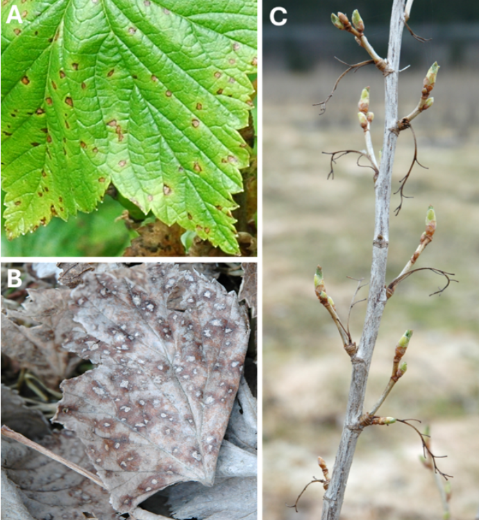
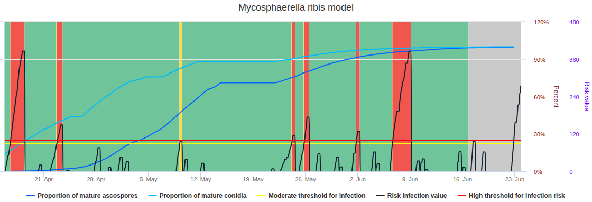

# Leaf Spot (*Mycosphaerella ribis*) in Blackcurrant
**&copy; 2026 NIBIO**

**Arne Stensvand, Håvard Eikemo, Anne-Grete Roer Hjelkrem**

The model indicates whether there is a risk of infection by the fungus *Mycosphaerella ribis*, which causes Mycosphaerella leaf spot in blackcurrant. The model is likely also suitable for forecasting infection by *Drepanopeziza ribis*, which causes anthracnose and leaf drop in the same crop. The two fungi have very similar life cycles and overlapping periods for spore dispersal and infection. There is considerable variation in susceptibility to Mycosphaerella leaf spot among blackcurrant cultivars used in Norway, but important cultivars such as ‘Ben Tron’ and ‘Ben Nare’ are highly susceptible. 

*Drepanopeziza ribis* overwinters as fruiting bodies in old leaves on the ground, where ascospores are formed and will be dispersed by wind during moist weather in spring. It also overwinters in old berry cluster stalks that remain on the bushes after machine harvesting, and from these, conidiospores (conidia) are splash dispersed by rain or overhead irrigation. The model describes spore maturation and the periods when dispersal of both ascospores and conidia may occur, which to a large extent happens during the same period in spring. At the same time, the model indicates when infection risk is present. 



*Fig 1. Leaf spot on fresh leaves (A). In spring, infection arises from ascospores produced in fruiting bodies in old leaves on the ground (B), and from conidia produced on old berry cluster stalks on the shoots (C). Photos: A. Stensvand.*

Spores are normally dispersed from before bud break until mid-June, although this varies somewhat between years. The most important period of spore dispersal is typically from a couple of weeks before to a couple of weeks after flowering. Maturation of both spore types in overwintered plant material depends on moisture. If there are extended periods without precipitation and moist conditions, maturation will therefore slow down or stop. Such dry periods are accounted for in the model. There is a diurnal rhythm in ascospore dispersal, with minimal dispersal at night. This is not adjusted for in the model because dispersal of conidia is not affected by light. 

Moisture is required for infection, and the infection period depends on temperature, with the shortest infection time occurring around 20°C. No separate infection model has been developed for *M. ribis*, but we use the same model as for apple scab (*Venturia inaequalis*), because the two fungi are closely related and presumably have similar infection dynamics. 

 

## Interpretation of the Forecast 

Green indicates periods with no infection risk. Yellow indicates periods where some spores have been dispersed, and that infection is beginning or may have occurred. “Some” spore dispersal means that less than 3% of the spores (relative to the amount predicted for the entire season) have matured since the previous dispersal event. Red indicates that enough spores (≥ 3% of the seasonal total) have matured and potentially been dispersed for a significant infection event, and that weather conditions may have allowed infection. The size (width) of the yellow and red bars indicates how long the moist conditions have been suitable for infection. The actual infection risk depends on how many spores that may have been dispersed when precipitation and moisture occur. The inoculum pressure in a given field is decisive and depends on the level of infection the previous year. The model is updated daily and shows a forecast based on recorded weather data and a 2‑day weather forecast. 

 


*Fig. 2. Forecast model for Mycosphaerella leaf spot using data from a weather station in Southern Norway in 2025: Percentage maturation of ascospores from old leaves (dark blue line) and conidiospores from old berry cluster stalks (light blue line); when accumulated infection risk based on temperature and leaf wetness (black line) crosses the yellow and red horizontal lines, there is moderate (yellow vertical area) or high (red vertical area) infection risk (measured as Risk Value).*

 

## Forecasting Season 
Forecasting begins around bud break and ends shortly after spore dispersal from overwintered plant material has finished, usually in June. No forecasts are given for secondary infections, i.e., those caused by conidia produced in newly infected (current season) plant material. 

## Testing and Validation of the Model 
The model for blackcurrant leaf spot was developed in Norway and is based on data on spore maturation and dispersal under Norwegian conditions, but it has been compared with similar studies of *M. ribis* in other countries. The sub‑models for ascospore and conidiospore maturation/dispersal have been validated under Norwegian conditions. Since we use infection data developed for the apple scab fungus to forecast infection by *M. ribis*, there is some uncertainty as to whether it provides a fully accurate picture of infection risk. However, in most cases, moist periods are sufficiently long for the infection risk to be real. There will nevertheless always be significant local variation in moisture after rainfall, which introduces some degree of uncertainty. 

 

## Reference 
Stensvand, A., Eikemo, H. & Hjelkrem, A.-G., R. 2026. *Mycosphaerella ribis* in blackcurrant and patterns of spore release from overwintering sources of inoculum. *Plant Disease*. https://doi.org/10.1094/PDIS-08-25-1675-RE 

Stensvand, A., Eikemo, H., Hjelkrem, A.-G., R., Skog, T.-E. 2026. Varslingsmodell for bærbuskbladflekk i solbær. Norsk Frukt og Bær 29 (2):4-5. 


## Development

Clone Gitlab repository

```
$ git clone https://gitlab.nibio.no/VIPS/models/java/Model_MYCOSRIBIS.git
$ cd Model_MYCOSRIBIS
```

### Compile, run tests
```bash
mvn clean install
```

### Deploy to VIPSCore
See [the VIPSCore README](https://gitlab.nibio.no/VIPS/VIPSCore)